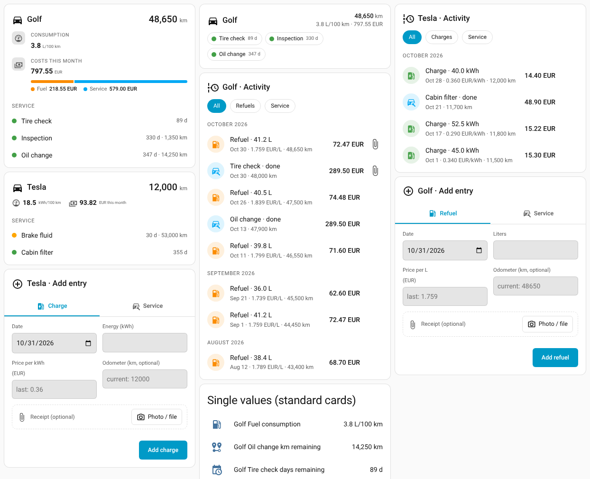

# Vehicle — Basic Vehicle Management for Home Assistant

[![HACS][hacs-badge]][hacs-url]
[![License][license-badge]][license-url]

A custom Home Assistant integration for tracking your vehicles: service and maintenance intervals, fuel and charging costs, and mileage. Modelled after [ha-task](https://github.com/Kogoro/ha-task): one config entry per vehicle, service items as subentries, UI configuration only.

## Features

- **Multiple vehicles** — one config entry (and one device) per vehicle: petrol, diesel, hybrid or electric.
- **Service & maintenance** — items such as oil change, tires or inspection with a day interval, a km interval, or both. An item is due when **either** limit is reached.
- **Mileage** — link an existing odometer sensor (miles are converted to km) or enter readings manually. Fuel/charge logs and completed services raise the manual odometer automatically.
- **Fuel & charging log** — log refuels (liters) and charges (kWh) with cost and odometer. Prices per liter / kWh are recorded with every entry for trends. Get consumption (L/100 km, kWh/100 km), cost per km and cost this month.
- **Receipts and invoices** — attach a photo or PDF to a fuel/charge entry or a completed service. Optionally let an AI task entity read date, amounts and prices from it to pre-fill the form.
- **Events and a blueprint** — `vehicle_service_due_soon`, `vehicle_service_overdue` and `vehicle_service_completed`, plus a ready-made notification blueprint.
- **Three Lovelace cards**, each with a visual editor: an **info** card (mileage, consumption, monthly costs, service status), an **activity** card (timeline of refuels, charges and services with links to receipts) and an **entry** card (add a refuel, charge or completed service, with receipt upload). Single values can be shown with any standard HA card.



Design mockups and decisions: [docs/design](docs/design).

## Installation

### HACS (recommended)

1. HACS → **Integrations** → ⋮ → **Custom repositories**.
2. Add `https://github.com/Kogoro/ha-vehicle` with category **Integration**.
3. Install **Vehicle** and restart Home Assistant.

### Manual

Copy `custom_components/vehicle/` into your `config/custom_components/` directory and restart.

## Configuration

### Add a vehicle

**Settings → Devices & Services → Add Integration → Vehicle**

| Option | Description |
|--------|-------------|
| Name | Vehicle name (must be unique) |
| Drive type | Petrol, diesel, hybrid or electric. Decides whether fuel and/or charge logging and statistics are available |
| Odometer entity | Optional. Any numeric sensor/number in km or mi. Used whenever it has a valid value, otherwise the manual odometer is used |
| Warn within (days / km) | An item counts as *due soon* when this close to its limit |

### Add service items

Open the vehicle entry and choose **Add service item**:

- **Repeat every (days)** and/or **Repeat every (km)** — at least one is required.
- **Last done on / Odometer at last service** — baseline for the first due date. The date defaults to today. If you leave the odometer empty, tracking of the km interval starts at the odometer when first seen.

## Entities

Per vehicle:

| Entity | Description |
|--------|-------------|
| `sensor.<vehicle>_odometer` | Odometer in km. Attributes: `source` (`sensor`/`manual`), `fuel_type`, `activity` (newest 40 refuels, charges and service completions, merged) |
| `sensor.<vehicle>_fuel_price` | Price per liter of the latest refuel (not for electric); history/trends via HA statistics |
| `sensor.<vehicle>_energy_price` | Price per kWh of the latest charge (hybrid/electric) |
| `sensor.<vehicle>_fuel_consumption` | Average L/100 km (not for electric). Attribute `recent` |
| `sensor.<vehicle>_energy_consumption` | Average kWh/100 km (hybrid/electric). Attribute `recent` |
| `sensor.<vehicle>_cost_per_km` | Fuel + charge cost per km |
| `sensor.<vehicle>_cost_this_month` | Fuel + charging cost in the current month. Attributes `fuel` and `energy` hold the split |
| `sensor.<vehicle>_service_cost_this_month` | Cost of services completed in the current month (from the cost you enter when completing them) |

Per service item (these share the vehicle's single device, so the UI shows one device per vehicle; the item's name is part of the entity name):

| Entity | Description |
|--------|-------------|
| `sensor.<vehicle>_<item>` | Status: `ok`, `due_soon`, `overdue`, `unknown`. Attributes with last/next due, days and km remaining |
| `sensor.<item>_days_remaining` | Only if a day interval is set; negative when overdue |
| `sensor.<item>_km_remaining` | Only if a km interval is set; negative when overdue |
| `binary_sensor.<item>_overdue` | `on` when overdue |
| `button.<item>_complete` | Records the service as done today at the current odometer |

Statistics notes: no full tank or full battery is assumed. Consumption over a span of entries is everything added after the first entry divided by the distance since it, so it becomes more accurate with more entries (`recent` covers the last 3 intervals). Entries need an `odometer` value to be included in consumption and cost-per-km.

## Services

| Service | Description |
|---------|-------------|
| `vehicle.set_odometer` | Set the manual odometer. Lower values are rejected unless `allow_decrease: true` |
| `vehicle.add_fuel` | Log a refuel: `liters`, `price_per_liter` (or `total_cost`, from which the price is derived), `odometer`, `date` |
| `vehicle.add_charge` | Log a charge: `kwh`, `price_per_kwh` (or `total_cost`), `odometer`, `date` |
| `vehicle.complete_service` | Record a service item as done: `odometer`, `date`, `cost`, `receipt` |
| `vehicle.upload_receipt` | Store a file uploaded via HA (`/api/file_upload`) and return a `receipt` id (response service) |
| `vehicle.scan_receipt` | Read values from a receipt with an AI task entity (response service, nothing is saved) |
| `vehicle.attach_receipt` | Attach a `receipt` to an existing log entry (`log_entry_id`) or to the latest completion of a service item |
| `vehicle.delete_log_entry` | Delete a fuel/charge entry (`log_entry_id`, see `activity` on the odometer sensor) with its receipt |

`add_fuel`, `add_charge` and `complete_service` also accept an optional `receipt` id.

All services take an `entity_id`; any entity of the vehicle (or service item for `complete_service`) works.

```yaml
action: vehicle.add_fuel
data:
  entity_id: sensor.golf_odometer
  liters: 42.3
  price_per_liter: 1.683
  odometer: 45210
```

## Lovelace cards

The cards are registered automatically. Add them from the dashboard editor ("Vehicle info", "Vehicle activity", "Vehicle: add entry") and choose the **vehicle** in the visual editor; there is exactly one device per vehicle (e.g. *Golf*). In YAML, use either `device` (the device id) or `entity` (any entity of the vehicle, e.g. its odometer sensor). Only options you change are saved to the card. Mockups of the layouts are in [docs/design](docs/design).

### `vehicle-info-card` — status at a glance

Mileage, consumption, costs this month and service status. Read-only; tapping a service item opens its details.

```yaml
type: custom:vehicle-info-card
entity: sensor.golf_odometer
layout: compact
```

| Option | Default | Description |
|--------|---------|-------------|
| `layout` | `normal` | `normal`, `compact` (stats on one line) or `minimal` (everything in the header, services as chips) |
| `show_title`, `title`, `icon` | `true`, vehicle name, `mdi:car` | Title row |
| `show_odometer` | `true` | Show the mileage |
| `show_consumption` | `true` | Average L/100 km and/or kWh/100 km (hybrids show both) |
| `show_costs` | `true` | Costs this month: fuel/charging plus service |
| `show_cost_split` | `true` | In `normal`: bar and legend splitting the costs (fuel, charging, service) |
| `show_services` | `true` | Show the service items |
| `service_layout` | `auto` | `auto` (one line each, chips in `minimal`), `list` (two lines), `rows` or `chips` |
| `service_filter` | `all` | `all` or `attention` (only overdue or due soon) |
| `max_services` | `0` | Limit the number of items (0 = all) |
| `show_headings` | `true` | Show the "Service" heading |

### `vehicle-activity-card` — what happened

A timeline of refuels, charges and completed services, grouped by month, with the cost and a paperclip that opens the stored receipt or invoice. Types a vehicle has no entries for do not appear (no "Charges" filter for a petrol car). The card only links files; uploading happens in the entry card.

```yaml
type: custom:vehicle-activity-card
entity: sensor.golf_odometer
show_charges: false
entries: 5
```

| Option | Default | Description |
|--------|---------|-------------|
| `show_refuels`, `show_charges`, `show_service` | `true` | Which types to show (a type also needs entries to appear) |
| `show_title`, `title`, `icon` | `true`, "<vehicle> · Activity" | Title row |
| `entries` | `8` | Entries shown; "Show more" loads the next batch |
| `show_filters` | `true` | Filter chips (shown when there is more than one type) |
| `group_by_month` | `true` | Month headings |
| `show_costs` | `true` | Cost per entry |
| `show_files` | `true` | Paperclip links to receipts and invoices |

### `vehicle-entry-card` — add an entry

Tabs for **Refuel**, **Charge** and **Service**, each with an optional receipt or invoice (photo or file). Tabs follow the vehicle: Refuel for petrol, diesel and hybrid, Charge for hybrid and electric, Service when the vehicle has service items.

```yaml
type: custom:vehicle-entry-card
entity: sensor.golf_odometer
show_service: false
```

| Option | Default | Description |
|--------|---------|-------------|
| `show_refuel`, `show_charge`, `show_service` | `true` | Which tabs to offer (also limited by the vehicle) |
| `show_title`, `title`, `icon` | `true`, "<vehicle> · Add entry" | Title row |

The Refuel and Charge tabs take date, amount, price per unit and optionally the odometer; the Service tab takes the service item, date, odometer and cost and records it as done. The cards call `vehicle.add_fuel`, `vehicle.add_charge` and `vehicle.complete_service`.

### Receipts and invoices

- Use the **Photo / file** button in the entry card. The file is attached when you press the button to add the entry. Photos are shrunk in the browser before upload. JPEG, PNG, WebP and PDF up to 15 MB are accepted.
- Files are stored in `config/.storage/vehicle_receipts/` (included in HA backups) and are only served to logged-in users at `/api/vehicle/receipt/<id>`. They are not reachable via `/local`. Uploads that are never attached are deleted after 24 hours; deleting a log entry, service item or vehicle deletes its files.
- **Scan with AI** appears when an `ai_task` entity exists. It sends the image to the AI provider you configured in Home Assistant (so it leaves your network if that provider is a cloud service), then fills the form for you to check. Values are never saved without your confirmation. With several AI task entities, set a preferred one in Home Assistant, or pass `ai_task_entity_id` to `vehicle.scan_receipt`.

## Notifications

The integration fires `vehicle_service_due_soon` and `vehicle_service_overdue` when an item **changes** to that status (not for items that already had it when Home Assistant started), and `vehicle_service_completed` when you complete one. Event data: `vehicle`, `service`, `days_remaining`, `km_remaining`.

A ready-made blueprint is installed to `config/blueprints/automation/vehicle/service_due.yaml`. **Settings → Automations → Create → Use a blueprint → Vehicle service due notification**, then choose whether to notify when *due soon*, *overdue* or both and what to do (default: a persistent notification such as "Golf: Tire check is overdue (-30 days)"). Pick your phone's notify action to get push notifications.

Or write it yourself:

```yaml
automation:
  - alias: "Vehicle service overdue"
    triggers:
      - trigger: event
        event_type: vehicle_service_overdue
    actions:
      - action: notify.mobile_app
        data:
          title: "{{ trigger.event.data.vehicle }}"
          message: "{{ trigger.event.data.service }} is overdue."
```

## Development

### Local test instance

Starts Home Assistant with the integration loaded, then creates a user (`dev` / `dev`) and two demo vehicles (a petrol car with fuel log and a linked-odometer EV with charges):

```bash
docker compose -f dev/docker-compose.yml up -d
```

```bash
python3 dev/seed.py
```

The seed also adds a **fake AI task provider** (`dev/config/custom_components/fake_ai_task`) that returns canned values instead of reading the image, so you can try *Scan with AI* without an AI account. It is for development only.

The seed creates the **Vehicle** dashboard itself (sidebar entry, from `dev/config/dashboards/vehicle.json`), whatever your `configuration.yaml` contains. It waits for Home Assistant to finish starting, so you can run it right after `docker compose up`. It is safe to repeat, also after an interrupted run. Open <http://localhost:8123/dashboard-vehicle>.

**Without Docker:** install Home Assistant (`pip install homeassistant`, Python 3.13 or newer) and run `dev/run-local.sh`, then `python3 dev/seed.py` in a second terminal. The script builds `dev/.local-config` with links to this repo; Home Assistant only loads integrations that live inside its own config directory, so starting `hass -c dev/config` directly does **not** find the `vehicle` integration and the seed fails with *"Invalid handler specified"*.

After code changes restart with `docker compose -f dev/docker-compose.yml restart` (or restart `dev/run-local.sh`). Reset everything by stopping Home Assistant and deleting the generated data: `dev/config/.storage` and the other generated files in `dev/config` (everything except `configuration.yaml`, `dashboards/` and `custom_components/fake_ai_task`) for Docker, or `dev/.local-config` for the local script. Tested with Home Assistant 2026.2 and 2026.10.

### Tests and lint

```bash
pip install pytest-homeassistant-custom-component home-assistant-frontend ruff
ruff check .
pytest
```

## License

Apache License 2.0 — see [LICENSE](LICENSE).

[hacs-badge]: https://img.shields.io/badge/HACS-Custom-orange.svg
[hacs-url]: https://hacs.xyz
[license-badge]: https://img.shields.io/github/license/Kogoro/ha-vehicle
[license-url]: https://github.com/Kogoro/ha-vehicle/blob/main/LICENSE
